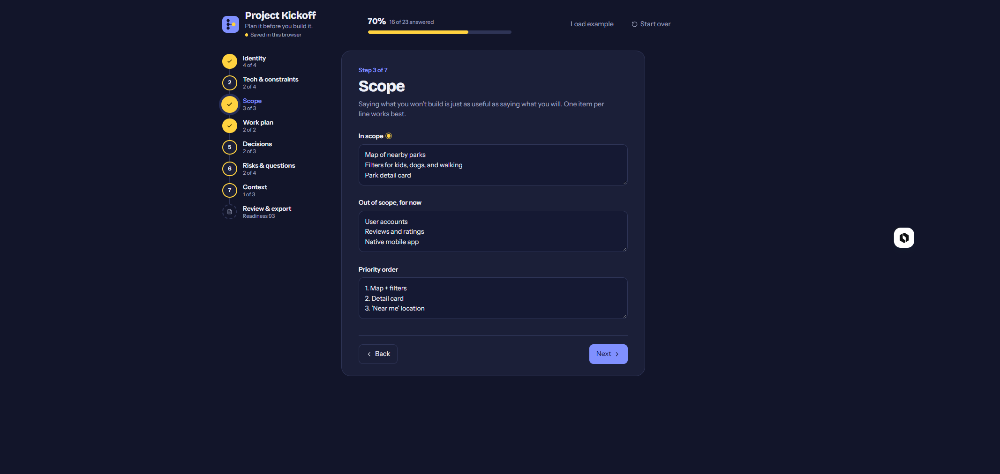
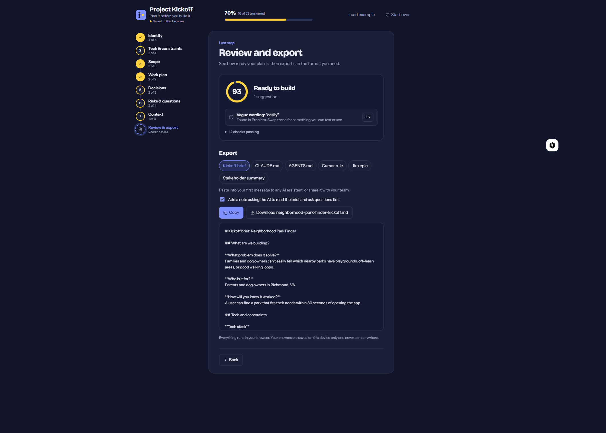
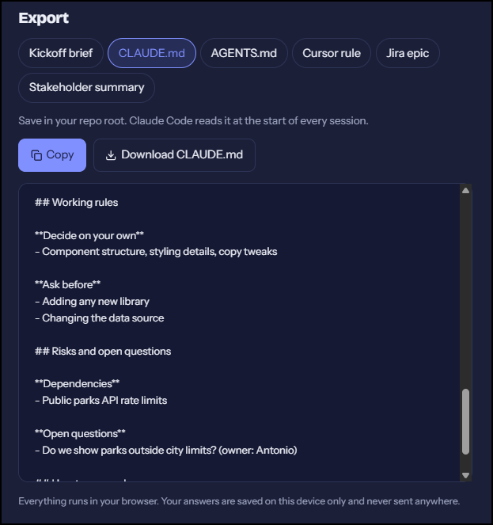

# Project Kickoff

**Plan it before you build it.**

A free, private planner for the earliest stage of a project. Walk through seven short steps, see how ready your plan is, and export it in the format your team or AI tool actually uses.

**[Open the app →](https://antdia4309.github.io/project-kickoff)**

<!-- Add a screenshot: save one as docs/screenshot.png and uncomment the line below -->


---

## Why it exists

Spec-driven tools like GitHub Spec Kit and Kiro start where the code starts. Project Kickoff starts where the idea starts.

- **Private by default.** Everything runs in your browser. Answers are saved on your device and never sent anywhere. No account, no install, no AI calls.
- **Built for business folks and developers alike.** Plain-language steps a product owner can fill in, with output a developer or coding agent can use straight away.
- **One plan, many formats.** Write it once, then export to whatever tool comes next.

## The seven steps

| Step | What you define |
|------|-----------------|
| 1. Identity | The problem, who it's for, and what success looks like |
| 2. Tech & constraints | Stack, structure, design system, conventions |
| 3. Scope | What's in, what's out, and in what order |
| 4. Work plan | The work broken into small sessions |
| 5. Decisions | What can be decided freely, what needs a check-in, what's off limits |
| 6. Risks & questions | Assumptions, dependencies, risks, open questions |
| 7. Context | Existing code and the output you want back |

Fields marked with a yellow dot are the minimum for a usable brief.

## Readiness check



Before you export, Project Kickoff scores your plan from 0 to 100 using simple rules, no AI involved. It flags things like:

- Success criteria with no number, time limit, or threshold
- An empty out-of-scope section
- More than eight must-haves
- No guardrails for what needs a check-in
- Vague words such as "fast," "easy," "user-friendly," or "seamless"

Each issue links straight to the step where you can fix it.

## Export formats



| Format | Use it for |
|--------|-----------|
| Kickoff brief (`.md`) | Your first message to any AI assistant, or a team handoff |
| `CLAUDE.md` | Project memory for Claude Code |
| `AGENTS.md` | Coding agents that follow the AGENTS.md convention |
| Cursor rule (`.mdc`) | `.cursor/rules/` in your repo |
| Jira epic | In-scope items become acceptance criteria, sessions become stories |
| Stakeholder summary | A plain-language recap for email or Teams |

Every format can be copied or downloaded.

## Run it locally

```bash
git clone https://github.com/antdia4309/project-kickoff.git
cd project-kickoff
npm install
npm start
```

Run the tests with `npm test`. Pushing to `main` runs the tests, builds the app, and deploys it to GitHub Pages.

## Project structure

```
project-kickoff/
├── .github/workflows/deploy.yml   # Test, build, and deploy to GitHub Pages
├── public/                        # index.html, icons, manifest
└── src/
    ├── App.js                     # The app: steps, readiness check, exports, styles
    ├── App.test.js                # Tests
    └── index.js                   # Entry point
```

## Built with

React 19, Create React App, and Lucide icons. Fonts: Bricolage Grotesque and Instrument Sans.

## Roadmap

- Ready-to-paste prompts for each work session
- Share a plan with a link, no backend needed
- Re-import an exported brief to keep editing it
- A simple decision log

## Author

**Antonio Diaz**
Business Analyst
B.S. Computer Information Science - Software Development, ECPI University (Summa Cum Laude, 4.0 GPA)

- Portfolio: [antdia4309.github.io/portfolio](https://antdia4309.github.io/portfolio)
- GitHub: [@antdia4309](https://github.com/antdia4309)

## License

MIT. Free to use, adapt, and build on. See [LICENSE](LICENSE).
